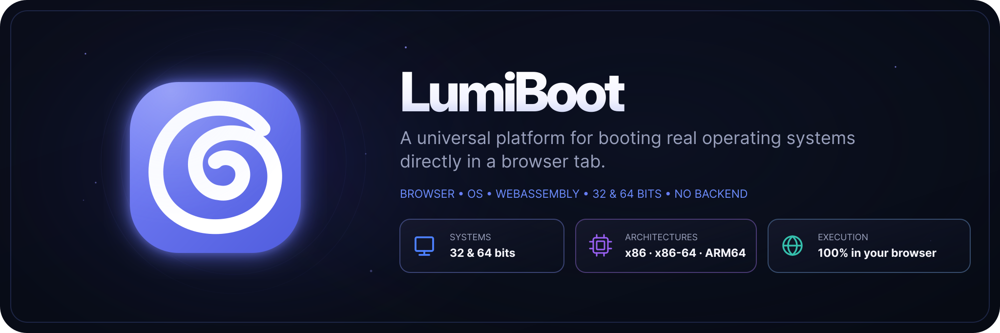

<div align="center">



<h3>A universal platform for booting real operating systems directly in a browser tab.</h3>

LumiBoot is a browser-based operating system emulation platform designed to run a wide range of real operating systems, from legacy 32-bit environments to modern 64-bit systems. Powered by WebAssembly, it emulates hardware directly on the user's device, allowing operating systems to boot and run entirely inside a browser tab, without installation, server-side virtualization, or dedicated software.

<p>
  
  <a href="LICENSE"></a>
</p>

[](https://github.com/AnthonyCodeDev/LumiBoot/actions/workflows/ci.yml)
[](https://github.com/AnthonyCodeDev/LumiBoot/actions/workflows/hygiene.yml)
[](https://github.com/AnthonyCodeDev/LumiBoot/actions/workflows/security.yml)

</div>

## Systems

| System              | Variants                 | Guest RAM               | Media                                    | Register with                      |
| ------------------- | ------------------------ | ----------------------- | ---------------------------------------- | ---------------------------------- |
| Debian 12           | XFCE / X11-Openbox / CLI | 1 GiB / 1 GiB / 512 MiB | built ext4 rootfs, kernel and initrd     | `images/debian-12-i386/build.sh`   |
| Ubuntu 18.04        | XFCE / X11-Openbox / CLI | 1 GiB / 1 GiB / 512 MiB | built ext4 rootfs, kernel and initrd     | `images/ubuntu-18-i386/build.sh`   |
| Fedora 44           | XFCE / CLI               | 2 GiB / 1 GiB           | built live ISO (squashfs), kernel/initrd | `images/fedora-44-x86-64/build.sh` |
| Alpine Linux 3.24   | XFCE / CLI               | 2 GiB / 1 GiB           | rebuilt virt ISO, preinstalled squashfs  | `images/alpine-3-24-x86-64/build.sh` |
| Windows 7           | Professional SP1 / Lite  | 1536 / 1024 MiB         | installed 32-bit BIOS/MBR RAW disk       | `pnpm assets:windows7:prepare`     |
| Windows 8.1 Pro x86 | 32-bit                   | 2048 MiB                | installed 32-bit BIOS/MBR RAW disk       | `pnpm assets:windows8:prepare`     |
| Windows 10 x86      | 32-bit                   | 2048 MiB                | installed 32-bit BIOS/MBR RAW disk       | `pnpm assets:windows10:prepare`    |
| Custom image        | ISO / IMG / RAW          | 512 MiB                 | `.iso`, `.img` or `.raw` you own         | Import it in the app               |

No disk, ISO or license key ships with the repository: prepare or import your own media before starting a session.

```bash
sudo ./images/debian-12-i386/build.sh
sudo ./images/ubuntu-18-i386/build.sh
sudo ./images/fedora-44-x86-64/build.sh
FLAVOR=xfce ./images/alpine-3-24-x86-64/build.sh
pnpm assets:v64:alpine:xfce
pnpm assets:windows7:prepare --source images/windows-7-pro-sp1-x86/disk.img
pnpm assets:windows8:prepare --source images/windows-8-1-x86/disk.img
pnpm assets:windows10:prepare --source images/windows-10-x86/disk.img
```

Disks are read-only: guest writes stay in memory and are lost on stop.

Per-system instructions, graphical variants and their FLAVOR values: [`docs/systems.md`](docs/systems.md).

## Requirements

- Node.js >= 20.
- pnpm 9.14.2, enabled with `corepack enable`.
- Go stable, only to build `apps/network-proxy`.
- A recent Chrome, Edge or Firefox.
- Linux or WSL2 to rebuild the Debian and Ubuntu images.

## Quick start

```bash
corepack enable
pnpm install
pnpm assets:prepare
pnpm dev
```

Open `http://127.0.0.1:5173`. `assets:prepare` fetches `v86.wasm` and the pinned BIOS files, verified by size and SHA-256 against `scripts/v86-assets.lock.json`.

## Commands

```bash
pnpm build                 # recursive build + Vite bundle
pnpm typecheck             # tsc --noEmit
pnpm lint                  # ESLint
pnpm format:check          # Prettier check; pnpm format rewrites
pnpm test                  # Vitest
pnpm test:e2e              # Playwright, port 5200
pnpm assets:check          # v86 binary integrity
pnpm assets:windows7:prepare|check
pnpm assets:windows8:prepare|check
pnpm assets:windows10:prepare|check
pnpm config:nginx          # render infra/nginx/*.conf from .env
pnpm config:nginx:check    # exit 1 when the rendered nginx files drifted
pnpm proxy:dev             # run the Go network proxy with .env applied
```

The real boot tests need several GiB of media and stay opt-in: `VM_E2E_ASSETS=1 pnpm test:e2e`. They are skipped otherwise.

## Architecture

| Path                    | Role                                                                            |
| ----------------------- | ------------------------------------------------------------------------------- |
| `apps/web`              | web interface, sessions, dynamic provider loading                               |
| `apps/network-proxy`    | local WISP V1 proxy in Go (`127.0.0.1:37892`)                                   |
| `packages/contracts`    | types and Zod schemas                                                           |
| `packages/catalog`      | images, profiles, engines, variants, availability                               |
| `packages/vm-core`      | engine contracts, registry, lifecycle                                           |
| `packages/provider-v86` | v86 integration, readiness, console, network                                    |
| `packages/provider-v64` | v64 x86-64 JIT, Workers, WebGPU and OPFS persistence                            |
| `packages/vm-assets`    | manifests, integrity, local disks                                               |
| `packages/vm-storage`   | versioned storage, quotas, backends; implemented, not wired to the sessions yet |
| `packages/vm-network`   | modes, profiles, capabilities, diagnostics                                      |
| `images`                | build scripts and manifests; binaries ignored                                   |
| `infra`                 | nginx, Docker dev, WISP relay                                                   |

UI → `VMRegistry` → dynamic import of the selected provider → manifest/media → emulator. Stop calls `stop()` then `dispose()`. Design notes: [`docs/ARCHITECTURE.md`](docs/ARCHITECTURE.md), [`docs/v64.md`](docs/v64.md).

## Troubleshooting

Disk reads go through HTTP Range requests. When a boot stalls on `/dev/sda` (the guest reads zeros), open **Disk diagnostics** under the session screen:

- disk reads are sent through `fetch(..., { cache: 'no-store' })` instead of the HTTP cache, so `allZero` being `true` on every read means something upstream rewrites the bytes (service worker, proxy, antivirus);
- If the panel shows `allZero` reads or statuses other than `206`, clear the site's data and unregister the service worker for this origin, then reload. **Copy** pastes the whole report, including the service-worker URL, into a bug report.

## Network

- `offline`: no NIC.
- `browser-fetch`: HTTP port 80 with CORS.
- `local-proxy`: outbound TCP through the local binary on `127.0.0.1:37892`, paired from its console.
- `user-relay`: a WISP relay you provide.

The profile is fixed before v86 starts; changing it requires a new session. `local-proxy` needs the network client from GitHub Releases, extracted into `apps/web/public/downloads/` for development. References: [`docs/network/network.md`](docs/network/network.md), [`docs/network/network-proxy.md`](docs/network/network-proxy.md).

## Security

- Proprietary images are never distributed by this repository.
- In production, the nginx configuration in [`infra/nginx/site.conf`](infra/nginx/site.conf) returns 404 for any Windows image under `/images/`; the development middleware that serves disks in place exists locally only.
- Origins and response headers are set in `infra/nginx`.
- Secrets are supplied only through environment variables.
- Report vulnerabilities privately, as described in [`docs/SECURITY.md`](docs/SECURITY.md) or through GitHub Security Advisories.

## Contributing

See [`CONTRIBUTING.md`](CONTRIBUTING.md). Contributions stay under the project license and keep the attribution to the original author; re-publication under another name is not allowed. Run `pnpm lint`, `pnpm typecheck` and `pnpm test` before a pull request.

## License

Released under the LumiBoot Source-Available License 1.0 ([`LICENSE`](LICENSE)): source-available, not OSI open source; personal, educational and evaluation use is allowed with attribution, and modified distributions keep the same license.
Third-party components keep their own terms, listed in [`docs/LICENSES.md`](docs/LICENSES.md).
Commercial use requires a paid license from the author.
