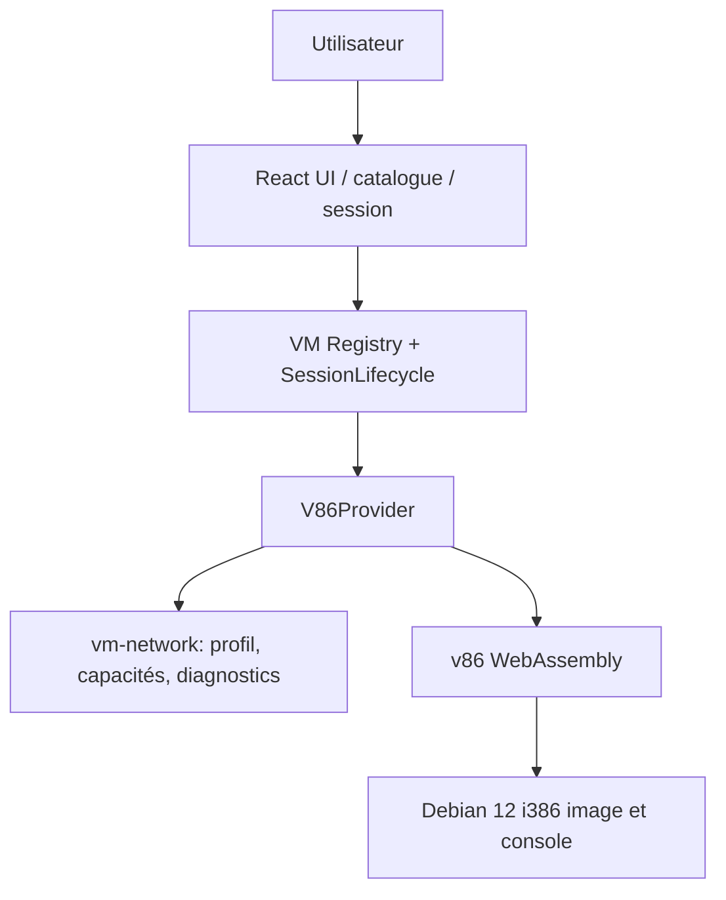

# LUMIBOOT — ARCHITECTURE TECHNIQUE

**État du dépôt livré :** ce document décrit l'**architecture cible** et son avancement. L'application
React (`apps/web`) et les packages `contracts`, `catalog`, `vm-core`, `vm-assets`, `vm-storage`,
`provider-v86` et `vm-network` existent. Le cœur `vm-core` est consolidé
(voir [`adr/0004-vm-core-consolidation.md`](adr/0004-vm-core-consolidation.md)) et le premier moteur
réel, v86, est branché derrière `VMEngine`. Le sous-système réseau commun est en place
(voir [`network.md`](network.md)). Les lots de persistance et les moteurs supplémentaires restent à
brancher. L'arbre ci-dessous reste une **cible d'évolution**, pas la liste exhaustive des fichiers.

## 1. Arborescence proposée

```text
lumiboot/
├── apps/
│   ├── web/                               # React + Vite + TypeScript
│   └── network-companion/                 # Compagnon réseau local (Go natif, serveur WISP V1
│   │                                      # sur loopback) — voir docs/network-companion.md
├── packages/
│   ├── contracts/                         # Types et Zod schemas partagés
│   ├── catalog/                           # Manifestes d'OS et compatibilités vérifiées
│   ├── vm-core/                           # Interface stable / session state machine
│   ├── vm-assets/                         # Manifeste d'assets, téléchargement, cache, SHA-256
│   ├── vm-storage/                        # Stockage persistant versionné et quotas
│   ├── vm-network/                        # Réseau commun agnostique (modes, capacités, profil,
│   │                                      # cycle de vie, diagnostics) — voir network.md
│   └── provider-v86/                      # Premier moteur réel côté client
├── images/
│   └── debian-12-i386/
├── infra/
│   ├── dev/docker-compose.yml             # Web et services de développement locaux
│   └── nginx/{site.conf,security-headers.conf}
├── tests/
│   └── e2e/{catalog.spec,session-debian.spec}.ts
├── docs/
│   └── adr/
├── .github/workflows/{ci,security}.yml
├── .env.example
├── eslint.config.js
├── tsconfig.base.json
├── pnpm-workspace.yaml
├── package.json
└── README.md
```

La référence `prototype/` doit rester disponible tant que la migration React n'est pas terminée. Les
fichiers `.img`, `.iso`, `.qcow2`, `.ext2` ne doivent pas être placés dans Git ; utiliser un stockage
d'assets avec checksums et cache adapté.

## 2. Architecture logique



`V86Provider` n'appelle aucune API de calcul. Le téléchargement des assets depuis HTTP/CDN ne
constitue pas du calcul distant. Le sous-système réseau (`vm-network`) est **local** : aucun backend
ni serveur réseau LumiBoot.

## 3. Contrats du catalogue (proposition)

```ts
type OSFamily = 'linux' | 'windows' | 'macos';
type ExecutionMode = 'browser';
type EngineId = 'v86' | 'wasm-x86' | 'wasm-x86_64' | 'wasm-arm' | 'wasm-powerpc' | 'wasm-68k';
type Availability = 'planned' | 'experimental' | 'ready' | 'unavailable';
type Architecture = 'i386' | 'x86_64' | 'arm64';

interface OSDefinition {
  id: string;
  slug: string;
  family: OSFamily;
  displayName: string;
  versionLabel: string;
  architecture: Architecture;
  executionMode: ExecutionMode;
  engineId: EngineId;
  availability: Availability;
  description: string;
  iconUrl: string;
  minMemoryMiB?: number;
  imageRef?: string; // identifiant de manifest, pas URL arbitraire de l'utilisateur
  requirements: string[];
  licenseNotes?: string;
}
```

**Ne pas inférer la compatibilité du moteur à partir du nom ou du numéro de version.** Chaque entrée a
un moteur explicitement assigné et un statut vérifié. Pour Windows/macOS, les assets peuvent être
fournis par l'utilisateur ou la plateforme en fonction des droits/licences applicables, jamais
automatiquement récupérés d'une source douteuse.

## 4. Contrat providers (proposition)

```ts
type VMState =
  | 'idle' | 'preparing' | 'downloading' | 'booting'
  | 'running' | 'stopping' | 'stopped' | 'error';

type SessionEvent =
  | { type: 'state'; state: VMState }
  | { type: 'progress'; phase: string; loadedBytes?: number; totalBytes?: number }
  | { type: 'error'; code: string; message: string }
  | { type: 'network'; network: NetworkDiagnostics };

interface VMConfiguration {
  memoryMiB?: number;
  vgaMemoryMiB?: number;
  bootDevice?: string;
  network?: NetworkProfile;   // @lumiboot/vm-network
  signal?: AbortSignal;
}

interface VMInstance {
  id: string;
  systemId: string;
  stop(): Promise<void>;
  dispose(): Promise<void>;
  subscribe(listener: (event: SessionEvent) => void): () => void;
  // Une UI console est proposée par un adapter séparé :
  // Browser v86 -> VGA/serial DOM.
}

interface VMEngine {
  readonly id: string;
  capabilities(): VMCapabilities;
  canRun(os: OSDefinition): boolean;
  start(os: OSDefinition, mountTarget: unknown, configuration?: VMConfiguration): Promise<VMInstance>;
}
```

Invariants :
- `canRun` doit rester déterministe et explicite ; les tests de compatibilité du navigateur s'ajoutent
  avant le lancement.
- Une seule transition `booting -> running` après preuve que le système invité est opérationnel, pas à
  la fin d'un timer JavaScript.
- `dispose()` est appelé en démontage composant et après `stop()` ; pas de worker WASM orphelin.
- Les erreurs sont typées et traduites en messages utilisateurs.
- Les snapshots et l'hibernation ne font **pas** partie du contrat minimal ; ajouter en capacités
  optionnelles après validation.
- La configuration réseau est appliquée **avant** le démarrage ; un changement de mode exige de
  recréer la session (voir [`network.md`](network.md)).

## 5. Routes UI et API

### Frontend

| Route | Contenu | Lot |
|---|---|---|
| `/` | Bibliothèque et système à la une | 0 |
| `/systems/:slug` | Fiche complète système | 0 |
| `/session/:id` | Console interactive et contrôles | 1 |
| `/settings` | Préférences | 2 |

La session navigateur peut avoir un ID généré localement. Elle n'a pas besoin d'un enregistrement dans
une DB distante.

## 6. Local only

- Toutes les ressources CPU et RAM utilisées par les systèmes viennent de la machine du visiteur.
- L'hébergement Web distribue uniquement l'application, les moteurs WebAssembly et les images système.
- Aucun backend de virtualisation, aucune passerelle VNC/RDP, aucun streaming vidéo n'entre dans
  l'architecture.
- La persistance locale repose sur IndexedDB et OPFS, avec validation et quotas.

## 7. Réseau

Le réseau est **commun à tous les OS et moteurs** et vit dans `@lumiboot/vm-network`. Il ne suppose ni
Ethernet ni VirtIO partout : il sépare la **NIC**, le **réseau local**, la **pile TCP-IP invitée** et le
**transport d'accès Internet**. Les modes `offline`, `browser-fetch` et `user-relay` sont implémentés ;
`local-network` est **prévu** (switch virtuel absent). `provider-v86` traduit un profil en `net_device`
(backend `fetch` ou relais WISP `wisps://`). L'exécution reste locale : **aucun backend ni serveur
réseau LumiBoot**.

**Aucun mode ne garantit « Internet complet » par simple sélection.** Trois niveaux doivent être
distingués : *configuré* (mode sélectionné), *techniquement supporté* (capacités déclarées par
`capabilitiesForMode`) et *réellement vérifié* (sondes runtime `dns`/`http`/`https`/`tcp`, jamais
déduites des compteurs `txBytes`/`rxBytes`). `fullInternet` est **faux pour tous les modes**.

Limites connues avec `v86@0.5.471` : `browser-fetch` ne fonctionne qu'en **HTTP (port 80)** — le
backend `fetch` de v86 n'enregistre pas le TCP 443, donc **HTTPS et `apt` échouent** — et reste
**soumis à CORS** (hôtes sans `Access-Control-Allow-Origin` refusés). `user-relay` ne transporte TCP
(dont 443) **que via un vrai relais WISP compatible v86** ; UDP est optionnel, ICMP non garanti, et
**aucun relais public n'est livré**. La configuration est **globale** (`public/lumiboot.config.json`
via `runtime.resolveNetworkProfile`) ; il n'y a **pas de page Settings**.

Détails, modes, capacités, fiabilité, sécurité et validation : [`network.md`](network.md). Décisions
structurantes : [`adr/0005-network-universal.md`](adr/0005-network-universal.md) et, pour un futur
transport TCP/UDP brut en Isolated Web App (non disponible aujourd'hui),
[`adr/0006-direct-sockets-iwa.md`](adr/0006-direct-sockets-iwa.md). Le **compagnon réseau local**
(`apps/network-companion/`, serveur WISP V1 sur loopback, mode `local-companion`) est décidé
dans [`adr/0007-network-companion.md`](adr/0007-network-companion.md) et documenté dans
[`network-companion.md`](network-companion.md).

## 8. Compatibilité initiale et ambitions

| OS / version | Exécution cible | Situation |
|---|---|---|
| Debian 12 i386 | Navigateur avec v86 | Premier système à réaliser et tester |
| Ubuntu historique i386 | Navigateur avec v86 | Étude de compatibilité, version par version |
| Fedora, Ubuntu et Mint modernes x64 | Navigateur avec moteur compatible local | Support local uniquement, sans backend de virtualisation |
| Windows anciens x86 | Navigateur avec moteur compatible local | Comportement et licence à vérifier |
| Windows 10/11 x64 | Non prioritaire | Aucun support direct par v86 ; dépend d'un moteur compatible local |
| macOS modernes | Navigateur avec moteur compatible local | Étude de faisabilité, sans infrastructure distante |
| macOS historiques Intel | Étude séparée par version | Ne pas promettre « toutes les versions » |

**Debian 13 n'est pas la bonne base pour le premier noyau i386 :** Debian a supprimé l'installateur et
le noyau i386 natifs à partir de Trixie. Debian 12 i386 est donc une cible de démarrage plus réaliste
pour v86.

## 9. Ressources pour vérifications techniques

- https://github.com/copy/v86
- https://github.com/leaningtech/webvm
- https://cheerpx.io/docs/licensing
- https://www.debian.org/ports/i386/
- https://guacamole.apache.org/doc/gug/
- https://developer.apple.com/documentation/virtualization
- https://www.apple.com/legal/sla/

## 10. Convention de qualité

- TypeScript strict, `noUncheckedIndexedAccess` conseillé, tests Vitest/Playwright.
- Les versions et licences des dépendances doivent être verrouillées (`pnpm-lock.yaml`).
- Suivre une convention de commit et documenter les choix structurants.
- Secrets côté API/agents uniquement. Les variables `VITE_*` sont publiques.
- Les composants UI ne font jamais `new V86(...)` directement.
- Tests automatiques de la state machine, des erreurs de lancement, des favoris, de la recherche et de
  l'accessibilité.
- Chargement lazy du moteur v86 et des assets système.
- Ajouter des en-têtes de sécurité compatibles avec les exigences réelles du WASM et de ses workers
  locaux (vérifier COOP/COEP selon la version intégrée).
